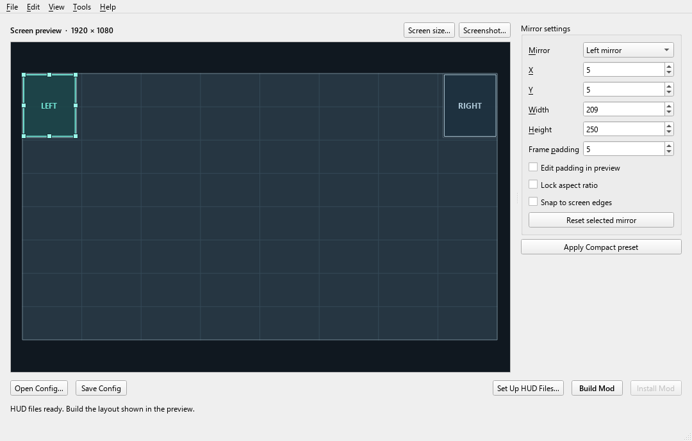

# ETS2 Configurable Mirrors

A Windows desktop editor for the left and right virtual mirrors in Euro Truck Simulator 2. Move and size each mirror in a virtual screen preview, save the layout to an INI file, and build a mod from HUD files extracted from your game version. The editor opens without ETS2 installed.

To use the ready-made Compact layout in ETS2, [subscribe to Compact Virtual Mirrors on Steam Workshop](https://steamcommunity.com/sharedfiles/filedetails/?id=3842480345).



## Download and use the editor

Download the Windows x64 `.exe` from [GitHub Releases](https://github.com/TurquoCabbit/ETS2_CompactVirtualMirrors/releases) and double-click it. The editor opens directly with a default layout and includes Python and Qt. It stores the default layout and build output under your local Windows app data. Use **File → Open Config** to bring in an existing layout.

The EXE is unsigned and Windows may block it under Smart App Control. The initial v0.2.0 upload was truncated and fails with a PyInstaller embedded PKG archive error. If you have that copy, check for a replacement in the release and compare its SHA-256 with the release's `SHA256SUMS.txt` before running it. Use `Get-FileHash -Algorithm SHA256` on the downloaded file. [Microsoft Smart App Control](https://support.microsoft.com/en-us/windows/security/threat-malware-protection/smart-app-control-frequently-asked-questions)

Choose game and output folders when you need them in **Tools → Directories**.

The packaged startup check has passed on Windows 11 x64, build 26300.9974. Clean-machine launch verification for Windows 10 and 11 x64 is pending.

1. Start with **Apply Compact preset** to edit the same layout used for the Compact Virtual Mirrors mod, or position and resize the mirrors in the preview.
2. Choose **Set Up HUD Files** when you are ready to build. The editor uses the detected Steam installation to suggest an extraction command and checks the two supplied HUD files before enabling **Build Mod**.
3. Build the layout, then select **Install Mod** or use **Tools → Open Output Folder** to inspect the generated archive. Enable the local mod for your profile in ETS2 Mod Manager. If you use the Compact Workshop item, disable it before enabling the custom build.

## Run from source

Use 64-bit Python 3.11 or newer on Windows 10 or 11. From the project folder in PowerShell, create a virtual environment and install the GUI dependency.

```powershell
py -3.12 -m venv .venv
.\.venv\Scripts\python.exe -m pip install -r requirements.txt
.\run_gui.bat
```

Replace `-3.12` with the installed Python version if needed. If `py` is unavailable, run `python -m venv .venv` after confirming `python --version` is at least 3.11. You can also launch directly with `.\.venv\Scripts\python.exe main.py` or run `python main.py` from an activated environment.

If launching from source fails, check the Python version and install `requirements.txt` with the same interpreter.

## Edit a layout

- Click a mirror or choose it in **Mirror settings**. Drag the body to move it, or use any corner or edge handle to resize. Use the numeric fields for exact values. With the preview focused, Arrow keys move one virtual unit and Shift+Arrow moves ten.
- Set **Frame padding** numerically or turn on **Edit padding in preview** and drag an amber handle on the selected mirror's outer frame. Padding is uniform on all four sides. Set it to zero for no extra border.
- **Lock aspect ratio** captures the selected mirror's current ratio. **Snap to screen edges** applies while dragging or resizing within eight virtual units of an edge. **Edit → Minimum Mirror Size** sets minimum dimensions for editing. Layouts loaded with smaller existing mirrors can still be opened and moved.
- **Reset selected mirror** restores the selected side from the extracted ETS2 HUD configured in **Directories**. The preview shows the standard preset with approximate frame padding. Rebuild and install the mod to apply all four original presets. Editing the mirror again switches that side back to a custom layout.
- **Screen size** sets the virtual canvas. Move or resize the mirrors to fit before shrinking the canvas. **Screenshot** displays a reference image fitted to the canvas with its aspect ratio intact. The screenshot is stored as a local preference and is excluded from the mod archive.
- **Save Config** updates the active INI and backs it up as `<name>.ini.bak`. **File → Save Config As** saves the current layout to another INI and opens it for editing. **File → Reload Config** rereads the active file. Extra sections and keys survive saves. INI spacing and comments can change when the file is rewritten.

## Build and install a mod

1. Download the official SCS archive tool and extract the archive that contains the target game's HUD files into a separate working directory. The locally inspected ETS2 1.62.3.3s installation stores both files in `base_share.scs`. The archive location can differ by version. [SCS Game Archive Packer](https://modding.scssoft.com/wiki/Documentation/Tools/Game_Archive_Packer)
2. In **Set Up HUD Files**, select the extraction root containing `ui/hud_left.sii` and `ui/hud_right.sii`, or select its `ui` subfolder. Use **Tools → Directories** to adjust the output and ETS2 mod directories. The editor suggests the Windows Documents ETS2 mod folder when available.
3. Select **Build Mod**. The GUI builds from the layout currently shown, including unsaved edits. The output is `ets2_configurable_mirrors.scs`.
4. Select **Install Mod** to copy the successful build for the current layout. Build again after changing the layout or build inputs. The editor asks before replacing an existing installation. Enable the mod for your profile in ETS2 Mod Manager. [SCS Mod Manager](https://modding.scssoft.com/wiki/Documentation/Engine/Mod_manager)

For example, run the following in PowerShell. When prompted, paste the folder shown for **ETS2 installation** in the editor and the path to your downloaded `scs_packer.exe`.

```powershell
$game = Read-Host 'ETS2 installation folder'
$packer = Read-Host 'Full path to scs_packer.exe'
New-Item -ItemType Directory -Force -Path .\source_ui | Out-Null
& $packer extract (Join-Path $game 'base_share.scs') -root (Resolve-Path .\source_ui).Path
```

The editor uses extracted files as input and writes into the selected output or mod directory. Game archives and the ETS2 executable are untouched.

## Command-line build

`build.bat` uses the project-local `config.ini`, `source_ui`, and `output` by default. The CLI needs only Python 3.11+ and the standard library.

```powershell
.\build.bat
.\build.bat --config .\config.ini --source .\source_ui --output .\output
.\.venv\Scripts\python.exe -m mirrors.cli --help
```

The INI format uses `[screen]` with `width` and `height`, and separate `[left]` and `[right]` sections with `x`, `y`, `width`, `height`, and `frame_padding`. Geometry values are integers in virtual screen units. The optional `use_game_defaults = 1` setting copies that side's original HUD into the build. It defaults to `0`. Existing 1440 × 900 layouts can be used directly. GUI preferences are stored separately from the INI.

## HUD compatibility and troubleshooting

- The builder supports the plain-text, four-preset SII structure verified in the local 1.62.3.3s files. It matches native camera bindings, preset IDs and templates, and parent-child relationships. A custom rectangle applies to all four presets on its side. The builder preserves the game's anchors and bindings. ETS2 controls the in-game layout, preset selection, and F2 toggling.
- The editor uses a top-left origin. The builder maps the virtual canvas to each source HUD's reference bounds (1440 × 900 in the inspected files), reverses the Y axis, and rounds the rectangle edges to integers. Frame padding is clipped at the edges. Physical placement can vary with ETS2's aspect handling and display settings.
- If the HUD pair is missing or incompatible, check the source directory and extract fresh HUD files from the ETS2 version you intend to use. If a fresh extraction has a different unit structure, the builder reports the unsupported field or structure and leaves any previous archive available. Keep your INI when replacing the source files.
- If the mod appears in Mod Manager but its layout is not visible, check that it is enabled for the correct profile. Other mods can replace the same two HUD paths.
- If saving or building fails with a permissions error, choose a writable directory and close applications holding the destination file open.

Automated tests use synthetic SII fixtures. A separate smoke build also verified archive creation using HUD files from the local ETS2 1.62.3.3s installation. In-game placement and F2 behavior have not been verified.

## Run the tests

```powershell
.\.venv\Scripts\python.exe -m pip install -r requirements-dev.txt
.\.venv\Scripts\python.exe -m pytest
```

## Maintainer releases

Run the following in PowerShell with Windows x64 Python 3.12. The script installs pinned dependencies in an isolated `.runtime` environment, runs pytest, and checks that the final EXE under `dist/v<version>` starts before writing its SHA-256 checksum.

```powershell
.\release.ps1
```

Use `-Python <path-to-python.exe>` to select a particular x64 Python 3.12 installation. Run `.\release.ps1 -Tag v<version>` from the clean checkout at the matching tag to produce the release EXE, checksum, notices ZIP, and source ZIP. Follow the draft and public download checks in the [maintainer handover](docs/maintainer-handover.md#maintain-and-release-the-windows-editor) before announcing the release.

See the [maintainer handover](docs/maintainer-handover.md) for ETS2 updates, validation, and Workshop maintenance. The [Workshop release instructions](workshop/README.md) include the listing copy and assets.

## Credits and license

Created by TurquoCabbit. Euro Truck Simulator 2 and the SCS Game Archive Packer are by SCS Software. The editor is licensed under [GPL-3.0](LICENSE). See the [third-party notices](THIRD_PARTY_NOTICES.md) for bundled software credits and source information.
